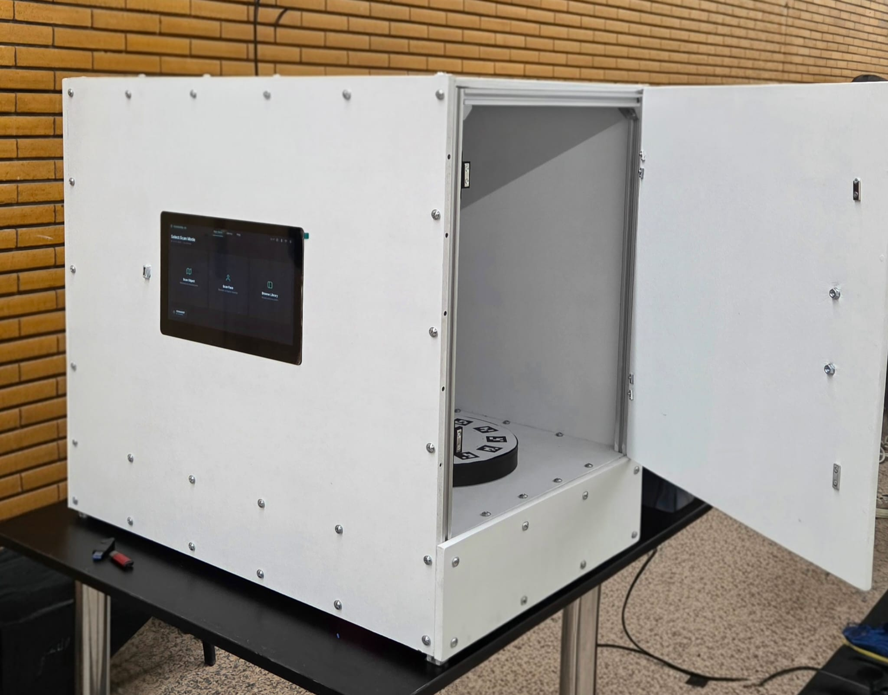
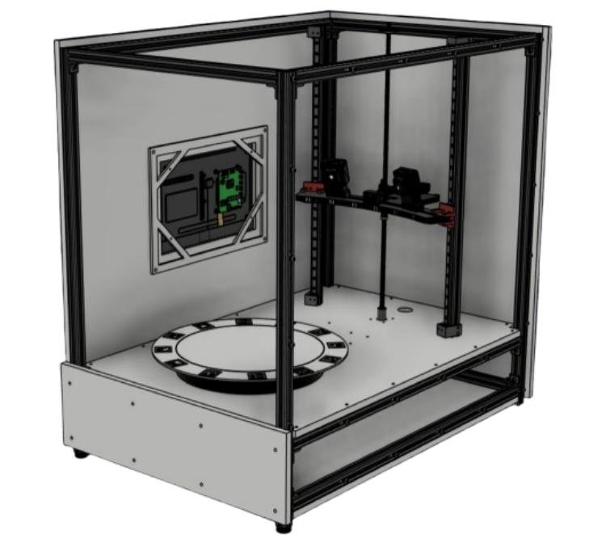
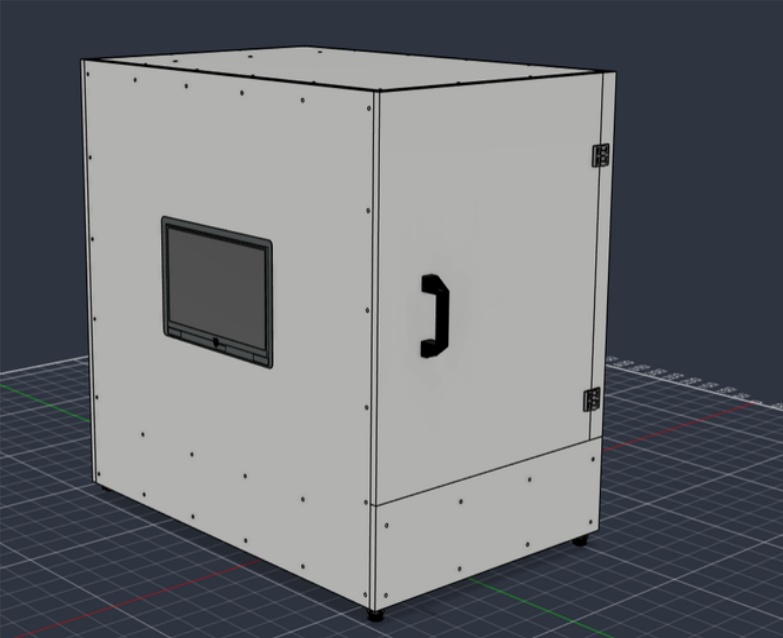
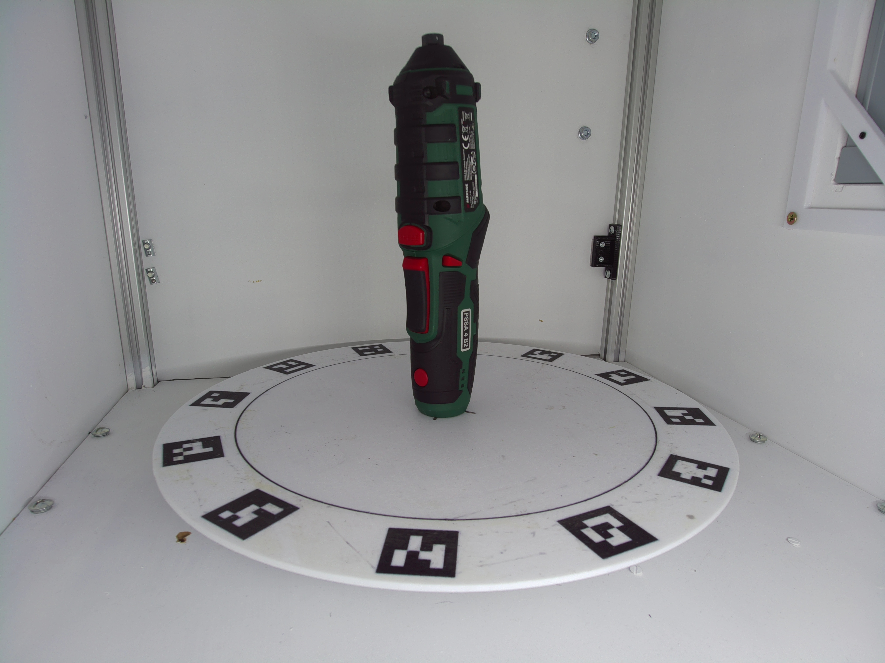
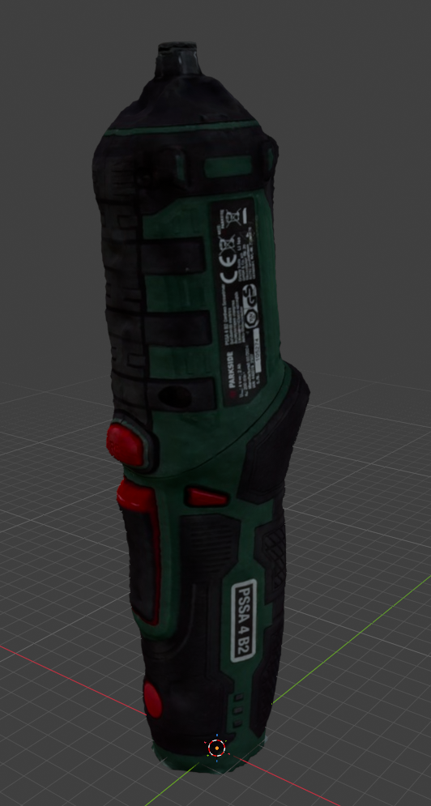
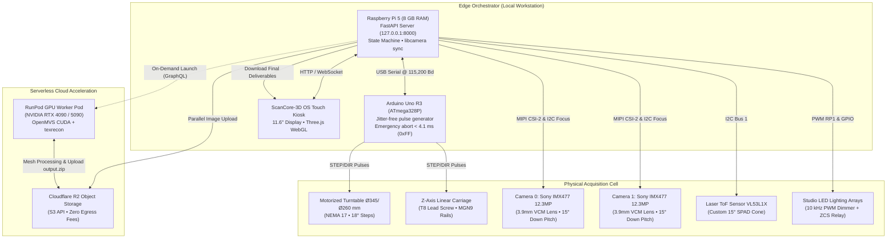

# 🛰️ ScanCore-3D — Autonomous Photogrammetric 3D Scanner (Edge-to-Cloud)

<div align="center">

[-gold?style=for-the-badge&logo=trophy)](#-about-the-project--team)
[](https://www.python.org/)
[](https://www.arduino.cc/)
[](https://www.docker.com/)
[](https://fastapi.tiangolo.com/)
[](https://threejs.org/)
[](https://runpod.io)

**An integrated mechatronic workstation for high-precision object photogrammetry and instant, offline biometric 3D facial reconstruction.**  
*Developed as a team project for the **Techallenge** engineering competition, where it was awarded an **Honorable Mention**.*

[Repository Ecosystem](#-repository-ecosystem) • [Architecture](#-edge-to-cloud-architecture) • [Hardware & Mechatronics](#%EF%B8%8F-hardware-specifications--mechatronics) • [Scanning Modes](#-dual-scanning-modalities) • [Results & Gallery](#-visual-gallery--results) • [Quick Start](#-quick-start-guide)

</div>

---

## 🏆 About the Project & Team

This repository serves as the **central hub and unified technical documentation** for the dual-modality 3D scanner developed by our team for the **Techallenge** engineering competition, where our entry received an **Honorable Mention**.

The scanner represents an end-to-end interdisciplinary engineering effort across multiple domains:
* **Mechanical & CAD Design:** Rigid $20 \times 20\text{ mm}$ aluminum extrusion framework, dual-rail MGN9 linear carriage, anti-backlash lead screw drive, axial thrust bearing turntable, and a custom diffuse optical enclosure designed in Autodesk Fusion 360.
* **Electronics & Embedded Firmware:** Power distribution, Zero-Current Switching (ZCS) relay protection, $10\text{ kHz}$ hardware PWM constant-current LED dimming, and sub-millisecond, deterministic stepper pulse generation on an ATmega328P microcontroller.
* **Edge Computing & Perception:** Asynchronous FastAPI operating system running on a Raspberry Pi 5, dual hardware-synchronized Sony IMX477 camera streams (`rpi.sync`), Time-of-Flight laser height sensing (VL53L1X), and real-time facial landmark tracking via MediaPipe.
* **Cloud Photogrammetry Pipeline:** Serverless GPU orchestration on NVIDIA RTX 4090/5090 workers via RunPod and zero-egress asset staging through Cloudflare R2, combining OpenMVS CUDA PatchMatch with Markov Random Field texture synthesis (`mvs-texturing`).
* **Human-Machine Interface (HMI):** Touch-optimized kiosk web OS (ScanCore-3D OS) running on an 11.6" display, featuring a Three.js WebGL viewport with Draco decompression, live dual-camera video feeds, and direct mobile export via QR codes.

---

## 🔗 Repository Ecosystem

The project is structured into three primary repositories forming the complete hardware, reconstruction, and interface stack:

| Repository & Link | Role in the Ecosystem | Key Technologies |
|---|---|---|
| 🛰️ **[3d-scanner-raspberry-pi](https://github.com/AlinC10/3d-scanner-raspberry-pi)** | **Edge Orchestrator, Motion Firmware & Integrated Facial Reconstruction:**<br>Serves as the host backend (`127.0.0.1:8000`) and hardware supervisor. Manages the system state machine, Arduino Uno pulse generation, dual synchronized Sony IMX477 camera drivers (`rpi.sync`), VL53L1X laser telemetry, and houses the complete embedded 3D facial scanning pipeline:<br>• `face_scan/`: Real-time perception, 478 MediaPipe landmarks, robotic Z auto-framing, and anti-blink burst capture.<br>• `rpi_face_mesh/`: Offline 3D metric triangulation, Trimmed Umeyama SVD canonical morphing, 27° cosine UV texture baking, and watertight solid STL/GLB export.<br>*(Note: The standalone `face_scan_pipeline` repository was used exclusively as an experimental R&D testbed; all production facial capture and 3D reconstruction logic is fully integrated directly into this repository).* | Python 3.13, FastAPI, C++ (Arduino), libcamera, Picamera2, MediaPipe, NumPy, TriMesh, SciPy |
| ⚙️ **[photogrammetry_pipeline](https://github.com/AlinC10/photogrammetry_pipeline)** | **Turntable Studio (Industrial Object Photogrammetry):**<br>High-precision photogrammetry pipeline engineered specifically for automated turntable scanning rigs. Features 23-parameter AprilTag kinematic pose locking (zero bundle adjustment drift on dark, glossy, or textureless technical plastics), multi-view silhouette hybrid mask fusion, 1.5mm Visual Hull voxel carving, OpenMVS CUDA PatchMatch depth estimation, Delaunay Graph-Cut meshing, MRF Potts chart texturing (`texrecon`), automated 3.0mm planar base slicing, 2D ear clipping, and multi-LOD packaging. | Python, CUDA 12, OpenMVS 2.x, mvs-texturing, Docker, PyMeshLab, RunPod API, Boto3 (R2) |
| 💻 **[3d-scanner-front-end](https://github.com/AlinC10/3d-scanner-front-end)** | **ScanCore-3D OS (Touchscreen Kiosk Front-End):**<br>Web-based kiosk operating system interface running in full-screen mode on the 11.6" capacitive touchscreen (via the `cage` Wayland compositor). Delivers a responsive, desktop-grade experience with dual-camera live MJPEG streams, Three.js 3D viewport with Draco decompression, background multi-scan tracking drawer, virtual touch keyboard, diagnostic developer workbench, and mobile QR download generator. | HTML5, Modern CSS Tokens, Vanilla JS, Three.js, Draco, Kiosk Compositor (Cage / Chromium) |

---

## 📸 Visual Gallery & Results

### 1. Physical Scanner Rig & Autodesk Fusion 360 CAD Model
<div align="center">
  <table>
    <tr>
      <td align="center"><b>Assembled Physical Scanner Rig</b></td>
      <td align="center"><b>Internal Frame, Z-Carriage & Platter (CAD)</b></td>
      <td align="center"><b>Enclosure & Kiosk Screen (CAD)</b></td>
    </tr>
    <tr>
      <td></td>
      <td></td>
      <td></td>
    </tr>
  </table>
</div>

### 2. Reconstructed Industrial Mechanical Part (Real Object vs. 3D Model)
Demonstration on a Parkside cordless screwdriver shell (dark, semi-glossy technical plastic with minimal surface texture):
<div align="center">
  <table>
    <tr>
      <td align="center"><b>Physical Test Object (Photograph)</b></td>
      <td align="center"><b>Reconstructed Textured 3D Model (Dense Mesh + Watertight Base)</b></td>
    </tr>
    <tr>
      <td></td>
      <td></td>
    </tr>
  </table>
</div>

> [!NOTE]
> **Data Privacy & Biometric Disclaimer (GDPR):**  
> The scanner features a fully operational, sub-second **3D Facial Scanning Mode** with local offline reconstruction. To respect individual privacy and comply with GDPR regulations, 3D facial scans and identifiable portraits of human subjects **have been deliberately excluded from this public repository**. The facial pipeline code is fully reproducible and generates solid, watertight STL/GLB models directly when running on physical hardware.

---

## 🏛️ Edge-to-Cloud Architecture

The system decouples real-time physical acquisition at the edge from computationally intensive dense reconstruction in the cloud:



---

## ⚙️ Hardware Specifications & Mechatronics

The acquisition unit operates as a cylindrical-coordinate manipulator enclosed in a photometrically controlled chamber.

| Subsystem | Component | Operational Parameters & Highlights |
|---|---|---|
| **Host Processing** | Raspberry Pi 5 (8 GB) | Broadcom BCM2712 Quad Cortex-A76 @ 2.4 GHz, RP1 I/O co-processor, active cooler. |
| **Motion Controller** | Arduino Uno R3 | ATmega328P @ 16 MHz, trapezoidal velocity profile, emergency abort latency $\le 4.1\text{ ms}$. |
| **Stereo Optics** | 2× Sony IMX477 | 12.3 MP ($4056 \times 3040$), rolling-shutter hardware sync (`rpi.sync` offset $< 100\,\mu\text{s}$). |
| **Camera Lenses** | Motorized M12 $3.9\text{ mm}$ | 10-bit Voice Coil Motor (VCM) autofocus (1024 steps), $27^\circ$ horizontal convergence. |
| **Turntable Kinematics**| NEMA 17 + TB6600 | $1/16$ microstepping, $0.1125^\circ/\text{step}$ resolution, 160 microsteps for an $18^\circ$ step. |
| **Vertical Kinematics** | NEMA 17 + T8 Screw | $8\text{ mm}$ lead, dual MGN9 linear rails, vertical resolution of $0.01\text{ mm}$ ($10\,\mu\text{m}$). |
| **Height Telemetry** | ST VL53L1X ToF Laser | 940 nm Class 1 (eye-safe), programmed SPAD ROI narrowing detection cone to $\approx 15^\circ$. |
| **Studio Illumination** | 12V High-CRI LED Strips| Hardware PWM dimming at $10\text{ kHz}$ (eliminates rolling-shutter banding), ZCS relay. |
| **Touch Display** | 11.6'' IPS Touchscreen | Capacitive touch ($1366 \times 768$), running in full-screen Wayland kiosk mode (`cage`). |
| **Power Distribution** | Industrial 12V / 30A PSU | $360\text{ W}$ capacity ($\approx 120\text{ W}$ peak system draw, $3\times$ safety margin), 5V DC-DC bucks. |

> Complete kinematic derivations, velocity curves, and the full KiCad electrical schematic are documented in [docs/HARDWARE_AND_ELECTRICAL.md](docs/HARDWARE_AND_ELECTRICAL.md).

---

## 🎯 Dual Scanning Modalities

### 1. Object Photogrammetry (Turntable Mode)
* **Locked Camera Poses (Zero BA Drift):** A calibrated ring of AprilTags on the platter fits a 23-parameter global kinematic model. Camera poses are locked rigidly in metric coordinates, preventing the rotational drift and bending common in classical Bundle Adjustment when scanning textureless or glossy plastics.
* **Vernier Interleaved Sampling ($1.5\times$):** The $27^\circ$ camera convergence angle paired with the $18^\circ$ turntable step forms an exact $1.5\times$ Vernier ratio ($27^\circ = 18^\circ + 9^\circ$). From just 20 physical motor stops per level, the system captures **40 distinct horizontal perspectives spaced at $9^\circ$ intervals**.
* **Adaptive ToF Laser Height Cutoff:** After each $360^\circ$ revolution, the laser rangefinder checks if the object is still present in the optical path. When the laser registers the empty background ($> 350\text{ mm}$), vertical indexing halts immediately.
* **OpenMVS & texrecon Pipeline:** Multi-view depth maps are solved via CUDA PatchMatch, fused into dense point clouds, meshed via Delaunay tetrahedralization with Graph-Cut optimization, and textured via Markov Random Field (MRF Potts) energy minimization.
* **Watertight CAD Base (2-Manifold):** Automates planar slicing at $Y = 3.0\text{ mm}$, seals boundary loops via 2D ear clipping (Mapbox Earcut), and applies volume-preserving Taubin smoothing for ready-to-print 3D models.

### 2. Biometric Facial 3D Reconstruction (Integrated Face Mode)
*Natively executed on the Raspberry Pi 5 (`3d-scanner-raspberry-pi`) via in-process perception (`face_scan/`) and an isolated offline reconstruction subprocess (`rpi_face_mesh/`).*
* **Robotic Eye-Level Auto-Framing:** Live preview feeds continuously evaluate 478 MediaPipe facial landmarks, computing vertical metric error ($\Delta Z\text{ mm}$) to automatically jump the carriage to eye level.
* **Sub-Second Stereo Burst:** Human subjects cannot maintain rigid immobility over long periods. The scanner fires a hardware-synchronized 4-pair stereo burst in $< 1\text{ second}$.
* **Anti-Blink Blendshape Filter:** Eyelid openness blendshapes (`eyeBlinkLeft`, `eyeBlinkRight`) automatically select the sharpest frame pair with open eyes.
* **Local Metric Triangulation:** Landmarks are triangulated in physical millimeter coordinates and registered onto a canonical anatomical head mesh via Trimmed Umeyama SVD.
* **100% Offline Privacy:** The entire facial reconstruction pipeline executes locally on the Raspberry Pi 5 in 60–90 seconds. Biometric data never leaves the device.

> Complete mathematical formulations and algorithms are documented in [docs/ALGORITHMS_AND_MATHEMATICS.md](docs/ALGORITHMS_AND_MATHEMATICS.md).

---

## 📦 Output Deliverables Contract

Every completed scan packages a production-ready archive (`output.zip`) containing:

```text
output/
├── glb/
│   ├── high_model.glb         # High-Poly GLB with embedded PNG textures (Draco compressed)
│   └── low_model.glb          # Low-Poly GLB optimized for web viewports
├── obj/
│   ├── high/ (model_high.obj, model_high.mtl, model_high_texture.png)
│   └── low/  (model_low.obj, model_low.mtl, model_low_texture.jpg)
├── stl/
│   ├── high_model.stl         # Watertight, 2-manifold CAD mesh (Z-up, millimeters)
│   └── low_model.stl          # Watertight Low-Poly for 3D slicer preview
├── 3mf/
│   ├── high_model.3mf         # Modern additive manufacturing format with unit metadata
│   └── low_model.3mf
├── object.json                # Physical dimensions (LxWxH mm), volume (cm³), surface area
├── stats.json                 # Execution telemetry: RAM, VRAM, step timings, warnings
└── run_log.txt                # Complete execution log (UTF-8)
```

---

## 💰 Bill of Materials (BOM) vs. Commercial Scanners

The custom scanner achieves industrial-grade photogrammetry at approximately one-tenth the cost of commercial structured-light systems:

| System | Technology | Standalone Operation? | Reference Cost |
|---|---|:---:|:---:|
| **Zivid 2+ MR60** | Industrial Structured Light | No (Requires dedicated GPU workstation) | $\approx €11,390$ |
| **Artec Eva** | Handheld Structured Light | No (Requires external high-end laptop) | $\approx €14,900$ |
| **ScanCore-3D (Our System)** | **Autonomous Mechatronic Rig (Edge-to-Cloud)** | **Yes (Integrated Kiosk Touchscreen + On-Demand Cloud)** | **$\approx €1,160$ (Hardware)**<br>*(Total $\approx €1,227$ with prepaid cloud credits)* |

---

## 🚀 Quick Start Guide

This repository currently serves as the **overarching documentation hub and architecture portal** connecting the decoupled scanner components. The individual codebases are hosted across their respective repositories:

### 1. Edge Controller, Firmware & Backend Services
Manages the hardware state machine, motor pulse generation, camera capture, and serves the REST API:
* **Repository:** [`https://github.com/AlinC10/3d-scanner-raspberry-pi`](https://github.com/AlinC10/3d-scanner-raspberry-pi)
* **Development Mode (PC / Simulated Hardware without GPIO/RPi):**
  ```bash
  git clone https://github.com/AlinC10/3d-scanner-raspberry-pi.git
  cd 3d-scanner-raspberry-pi
  fastapi dev main_dev.py    # Alternatively: python main_dev.py
  # Interactive API documentation: http://127.0.0.1:8000/docs
  # Web UI automatically served at: http://127.0.0.1:8000/
  ```
* **Production Mode (Physical Raspberry Pi 5 with real hardware & GPIO):**
  ```bash
  cd 3d-scanner-raspberry-pi
  fastapi dev               # Alternatively: python main_prod.py
  ```

### 2. Touchscreen Kiosk User Interface (ScanCore-3D OS)
To develop or customize the web-based touch operating system interface:
* **Repository:** [`https://github.com/AlinC10/3d-scanner-front-end`](https://github.com/AlinC10/3d-scanner-front-end)
* **How to Run for UI Development:**
  The front-end is designed to communicate with the local FastAPI server (`http://127.0.0.1:8000`). Therefore, to work on the interface:
  1. Start the backend in development mode: `fastapi dev main_dev.py` (inside `3d-scanner-raspberry-pi`).
  2. Open `http://127.0.0.1:8000/` in your browser.
  *(Alternatively, if editing HTML/CSS/JS standalone, serve via `python3 -m http.server 3000` inside `3d-scanner-front-end`; API requests will automatically route to the running FastAPI instance at port 8000).*

### 3. Industrial Photogrammetry Pipeline (Turntable Studio)
To run object 3D reconstruction, AprilTag pose calibration, OpenMVS meshing, and texrecon texturing:
* **Repository:** [`https://github.com/AlinC10/photogrammetry_pipeline`](https://github.com/AlinC10/photogrammetry_pipeline)
* **Quick CPU Mock Run (No GPU Required):**
  ```bash
  git clone https://github.com/AlinC10/photogrammetry_pipeline.git
  cd photogrammetry_pipeline
  python main.py --mock_openmvs --rig_mode --input_dir ./tests/sample_images --output_dir ./output_test
  ```
* **Production GPU Run via Docker:**
  ```bash
  docker compose run --rm turntable-studio --input_dir /workspace/input_images --output_dir /workspace/output --rig_mode
  ```

> [!NOTE]
> **Unified Root Execution Notice:**  
> Unified multi-repository cloning and execution directly from this single directory (e.g., via `git clone --recurse-submodules`) will be enabled once the Git Submodules setup outlined in `GITHUB_IMPLEMENTATION.md` is executed. Until then, please clone and run each subsystem from its respective repository listed above.

---

## 📚 Extended Technical Documentation

* 📄 **[docs/HARDWARE_AND_ELECTRICAL.md](docs/HARDWARE_AND_ELECTRICAL.md)** — Detailed kinematics, microstepping math, trapezoidal speed profiles, 10 kHz PWM dimming, and complete controller pinout.
* 📄 **[docs/ALGORITHMS_AND_MATHEMATICS.md](docs/ALGORITHMS_AND_MATHEMATICS.md)** — 23-parameter AprilTag kinematic model, OpenMVS reconstruction math, MRF Potts texturing, and Umeyama SVD facial alignment.
* 📄 **[info/3d_scanner_electrical_scheme.pdf](info/3d_scanner_electrical_scheme.pdf)** — Vector KiCad electrical schematic of the scanning cell.

---
