# Algorithms, Calibration, and Mathematical Formulations

This document provides a rigorous mathematical breakdown of the computer vision algorithms, geometric calibration models, and surface reconstruction techniques powering the 3D scanning pipeline.

---

## 1. Kinematic Turntable Model & Pose Locking (Zero BA Drift)

### Why Avoid Classical Structure-from-Motion (SfM)?
In standard photogrammetry of industrial mechanical parts (e.g., dark technical plastics, glossy automotive shells, or smooth tools), feature-based matching algorithms (SIFT, ORB) struggle to detect consistent descriptors. Running Bundle Adjustment (BA) under these conditions leads to severe rotational drift, catastrophic point cloud bending, and an arbitrary coordinate scale.

In our automated turntable cell, camera trajectories are not unknown: the cameras translate along a calibrated vertical column and the turntable indexes in precise angular increments. Camera poses are determined deterministically from a 23-parameter kinematic model calibrated on an **AprilTag fiducial disc (Tag36h11 / tag16h5)** and are **rigidly locked** throughout the reconstruction.

### Mathematical Formulation
The world coordinate frame is fixed to the turntable platter: the origin is at the disc center, the $Y$-axis points along the platter surface normal, and dimensions are expressed in metric units (meters).

For camera $c \in \{0, 1\}$ at vertical level $\ell$ and rotation step $k$, the camera rotation matrix $\mathbf{R}$ and optical center $\mathbf{C}$ are given by:
$$\mathbf{R} = \mathbf{R}_c \mathbf{R}_a(\theta_{\ell k})$$
$$\mathbf{C} = \mathbf{p} + \mathbf{R}_a^{\top}(\theta_{\ell k}) \Big(\mathbf{C}_c + (\ell - \ell_0) h \mathbf{u} - \mathbf{p}\Big)$$
$$\theta_{\ell k} = \sigma k \gamma + \delta_\ell$$

Where:
* $\mathbf{R}_a(\theta)$ is the rotation matrix by angle $\theta$ around the turntable rotation axis $\mathbf{a}$ passing through point $\mathbf{p}$ on the disc plane.
* $(\mathbf{R}_c, \mathbf{C}_c)$ is the initial pose of camera $c$ at the base level ($\ell_0$) and step 0.
* $h$ is the nominal vertical lift per level along the unit vector $\mathbf{u}$.
* $\sigma \in \{-1, +1\}$ denotes rotation direction, $\gamma$ is the true step angle, and $\delta_\ell$ is a fine angular correction per vertical tier.

The parameter vector $\boldsymbol{\Theta}$ contains 23 global unknowns (extrinsic and intrinsic parameters per camera, rotation axis orientation, lift vector, and angular step). It is solved using non-linear least squares with a robust Soft-$\ell_1$ loss function:
$$\min_{\boldsymbol{\Theta}} \sum_{j, m} \rho \left( \left\| \mathbf{x}_{jm} - \pi\left(\mathbf{R}_j(\boldsymbol{\Theta}), \mathbf{C}_j(\boldsymbol{\Theta}), \mathbf{X}_m\right) \right\|^2 \right)$$

* **Zero-Tag Prediction:** When large objects completely obscure the AprilTag markers on the platter during a scan, camera poses are computed directly from the calibrated kinematic matrix without requiring any visible markers.

---

## 2. Hybrid Mask Fusion & Visual Hull Voxel Carving

To ensure clean surface reconstruction and eliminate floating depth artifacts, background pixels are filtered before depth map computation:

1. **Hybrid Mask Fusion:**
   * **Deep Learning Segmentation:** Ultra-fast inference using `BiRefNet_lite` (512px, ONNX CPU) evaluated on a dynamic bounding crop around the object.
   * **Background Median Subtraction:** Photometric difference against an empty baseline capture per vertical level.
   * **Synthetic 3D Disc Projection:** Geometric clipping plane at $Y = 3.0\text{ mm}$ to remove the turntable rim and AprilTag markers.
2. **Visual Hull Voxel Carving ($1.5\text{ mm}$ Grid):**
   * Multi-view binary silhouettes are back-projected into a discrete $1.5\text{ mm}$ 3D voxel volume.
   * Proxy tracking points and depth candidates falling outside the intersecting visual hull volume are pruned immediately.

---

## 3. OpenMVS Dense Reconstruction & MRF Potts Texturing

Surface generation leverages the high-performance CUDA algorithms of **OpenMVS**:

1. **PatchMatch Multi-View Depth Maps:**
   * For every reference pixel $\mathbf{q}$, depth $d$ and surface normal $\mathbf{n}$ are estimated by maximizing the Normalized Cross-Correlation (NCC) over candidate planes warped into neighboring viewpoints via plane-induced homographies:
     $$\mathbf{H}_i(d, \mathbf{n}) = \mathbf{K}'_i \left( \mathbf{R}_i \mathbf{R}_0^{\top} - \frac{(\mathbf{C}_i - \mathbf{C}_0) \mathbf{n}^{\top}}{d} \right) \mathbf{K}_0'^{-1}$$
     $$(d, \mathbf{n})^* = \arg\max_{d, \mathbf{n}} \frac{1}{|\mathcal{V}|} \sum_{i \in \mathcal{V}} \mathrm{NCC}\Big(W_0(\mathbf{q}), W_i(\mathbf{H}_i \mathbf{q})\Big)$$
2. **Surface Extraction (Delaunay Tetrahedralization & Graph-Cut):**
   * Dense 3D points are partitioned into a 3D Delaunay tetrahedralization.
   * An energy minimization Graph-Cut extracts the optimal watertight boundary surface, followed by detail-preserving Laplacian smoothing.
3. **High-Fidelity Texturing (`texrecon`):**
   * Instead of naive texture averaging (which causes blurring) or unconstrained Poisson blending, `texrecon` formulates texture assignment as a Markov Random Field (MRF) with Potts energy.
   * Large, continuous UV charts are assembled by favoring camera views with the highest resolution and most perpendicular viewing angle.

---

## 4. Watertight CAD Base Sealing (2-Manifold Mesh)

To prepare models for direct 3D printing (STL / 3MF) without slicing errors:

1. **Planar Base Slicing:**
   * The mesh is cleanly cut at $Y = 3.0\text{ mm}$ above the platter plane, removing any residual contact geometry or turntable texture artifacts.
2. **2D Ear-Clipping Polygon Triangulation (Mapbox Earcut):**
   * Open boundary loops along the cut plane are identified and sealed into planar caps using robust 2D ear-clipping triangulation.
3. **Volume-Preserving Taubin Smoothing:**
   * A two-phase Taubin filter is applied to the newly sealed base boundary to eliminate sharp triangulation stepping without shrinking the object's physical volume.
   * The final asset is verified as a valid **watertight 2-manifold** surface.

---

## 5. Biometric Facial Reconstruction Pipeline

Scanning human subjects introduces unique constraints: living subjects cannot maintain rigid immobility over multi-second sweeps.

```mermaid
flowchart LR
    A["Dual Preview Streams (1024x768)"] --> B["MediaPipe FaceLandmarker<br/>(478 3D Landmarks)"]
    B --> C["Stereo Framing Analyzer &<br/>Metric Z-Carriage Jump"]
    C --> D["VCM Facial ROI Autofocus"]
    D --> E["Sub-Second Stereo Burst<br/>(Anti-Blink Blendshape Filter)"]
    E --> F["Calibrated Metric Triangulation<br/>(assets/rig_calibration.json)"]
    F --> G["Trimmed Umeyama SVD Alignment<br/>(Canonical Mesh Morphing)"]
    G --> H["Piecewise Affine UV Baking<br/>(27° Cosine Alpha Ramp)"]
    H --> I["Watertight Solid Export<br/>(GLB / OBJ / STL / 3MF)"]
```

1. **Robotic Auto-Framing:**
   * Real-time preview frames track 478 facial landmarks per camera.
   * The system computes vertical metric error ($\Delta Z\text{ mm}$) and positions the carriage at subject eye level in a single deterministic jump.
2. **Synchronized Burst & Anti-Blink Filtering:**
   * Captures a 4-pair stereo burst in $< 1\text{ second}$.
   * Blendshape weights (`eyeBlinkLeft`, `eyeBlinkRight`) evaluate eyelid openness, automatically selecting the sharpest frame pair with open eyes.
3. **Metric Triangulation & Umeyama SVD Alignment:**
   * Landmarks are triangulated in physical millimeter coordinates using calibrated camera matrices.
   * A Trimmed Umeyama SVD similarity transform registers anatomical feature points onto a canonical head mesh with Laplacian surface regularization.
4. **Piecewise Affine UV Texture Baking (27° Cosine Ramp):**
   * Full-resolution 12.3 MP captures from Camera 0 and Camera 1 are warped into a unified $2048 \times 2048$ texture atlas.
   * Along the nasal bridge, where camera incidence transitions across the $27^\circ$ convergence angle, a cosine alpha-blending ramp eliminates seam artifacts and lighting discontinuities.
5. **100% Offline Privacy (GDPR):**
   * Facial processing runs entirely on the local Raspberry Pi 5 in ~60–90 seconds. Biometric data is never uploaded to the cloud.
